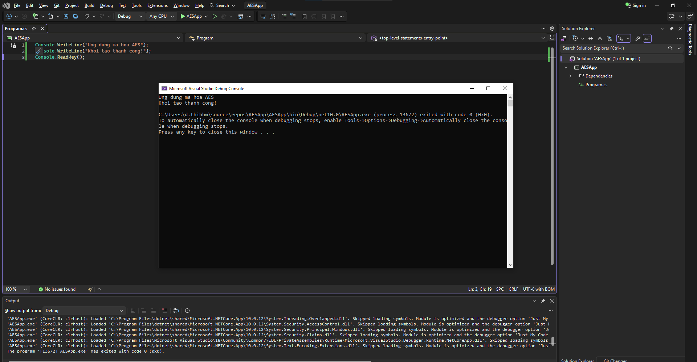
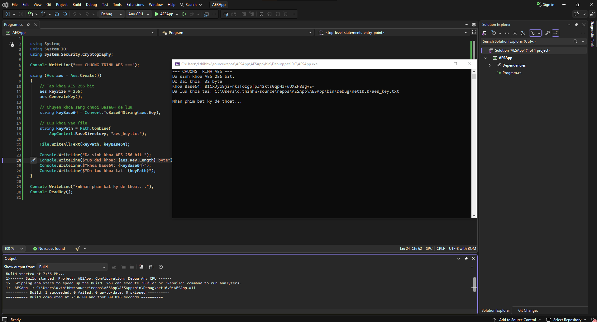
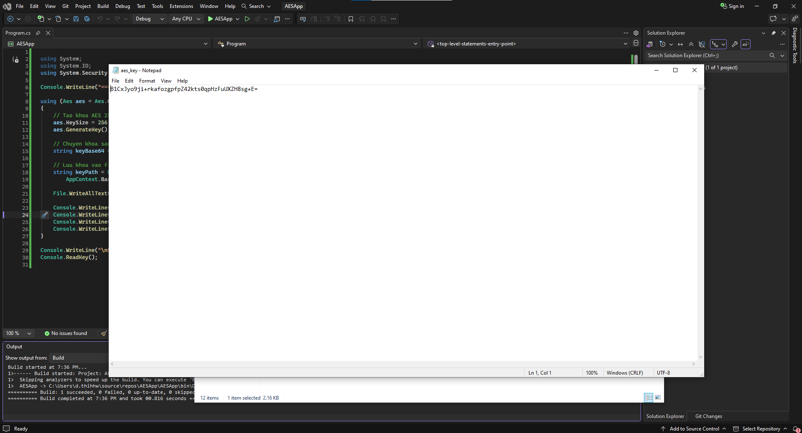
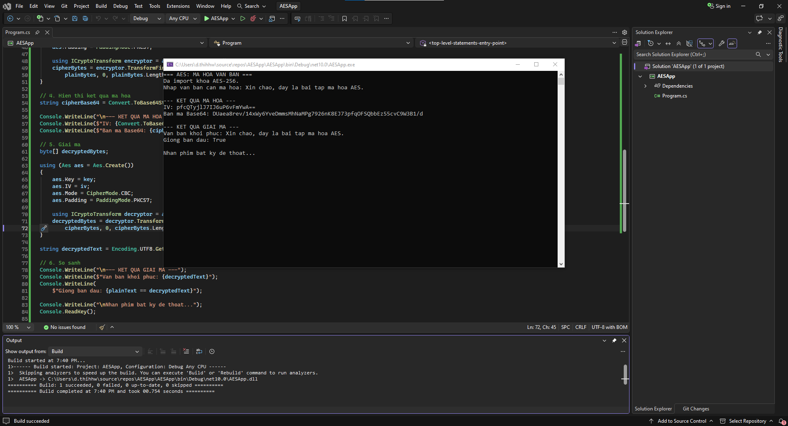
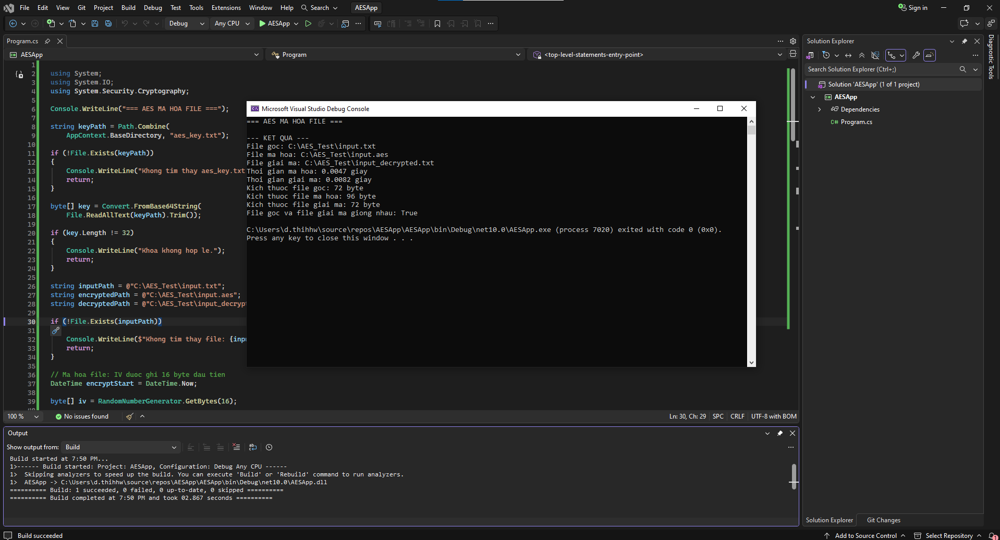
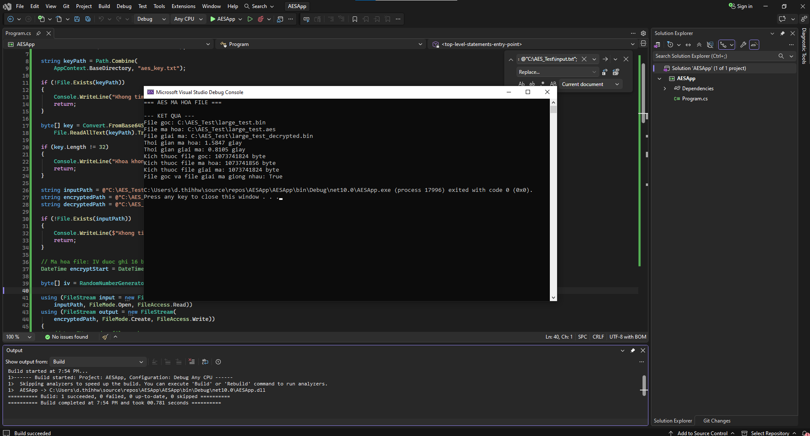

# Bài tập 1 – Mã hóa AES

**Môn học:** An toàn và bảo mật thông tin  
**Ngôn ngữ:** C#  
**Nền tảng:** .NET Console Application  
**Thuật toán:** AES-256

## 1. Mục tiêu

Xây dựng ứng dụng Console sử dụng AES để mã hóa và giải mã văn bản, file. Chương trình có chức năng sinh khóa, lưu khóa, import khóa, đo thời gian xử lý và so sánh dữ liệu sau giải mã với file ban đầu.

## 2. Các chức năng đã thực hiện

- Sinh khóa AES 256-bit (32 byte).
- Lưu khóa dưới dạng Base64 vào file.
- Import khóa từ file.
- Mã hóa và giải mã văn bản.
- Mã hóa và giải mã file bằng CryptoStream.
- Đo thời gian mã hóa và giải mã.
- So sánh file nguồn và file khôi phục theo byte.

## 3. Minh chứng thực hiện

### 3.1. Khởi tạo project

Tạo ứng dụng Console bằng Visual Studio 2022 và chạy thử chương trình.

**Giải thích:** Ảnh thể hiện project AESApp được tạo và chương trình Console chạy thành công.

### 3.2. Sinh khóa AES-256

**Giải thích:** Chương trình sinh khóa AES-256 có độ dài 32 byte. Khóa được chuyển sang Base64 để lưu vào file.

### 3.3. Lưu khóa ra file

**Giải thích:** Khóa được lưu vào aes_key.txt và có thể đọc lại để sử dụng cho các lần mã hóa, giải mã.

*Lưu ý: Không công khai giá trị khóa bí mật trong repository.*

### 3.4. Mã hóa và giải mã văn bản

**Giải thích:** Chương trình mã hóa văn bản đầu vào thành bản mã Base64, sau đó giải mã. Kết quả kiểm tra cho thấy văn bản khôi phục giống văn bản ban đầu.

### 3.5. Mã hóa và giải mã file nhỏ

**Giải thích:** File nguồn được mã hóa thành file .aes và giải mã thành file mới. Chương trình so sánh nội dung hai file theo byte và nhận kết quả trùng khớp.

### 3.6. Thử nghiệm file 1 GB

**Giải thích:** Chương trình được thử nghiệm với file có kích thước 1.073.741.824 byte. Kết quả ghi nhận:

| Đại lượng | Kết quả |
|---|---:|
| File gốc | 1.073.741.824 byte |
| File mã hóa | 1.073.741.856 byte |
| File giải mã | 1.073.741.824 byte |
| Thời gian mã hóa | 1,5847 giây |
| Thời gian giải mã | 0,8105 giây |
| So sánh byte | Trùng khớp |

**Nhận xét:** File sau giải mã có cùng kích thước và nội dung byte với file gốc. Chương trình xử lý file theo luồng, phù hợp với thử nghiệm dữ liệu lớn. Thời gian thực hiện có thể thay đổi theo cấu hình máy và tốc độ lưu trữ.

